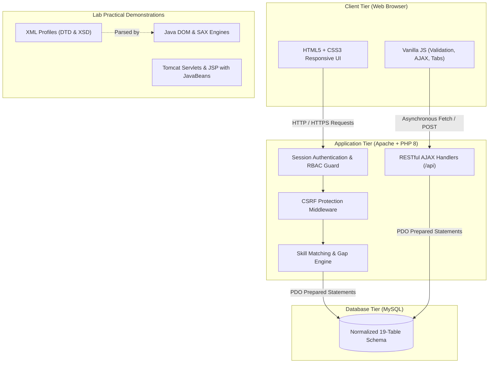
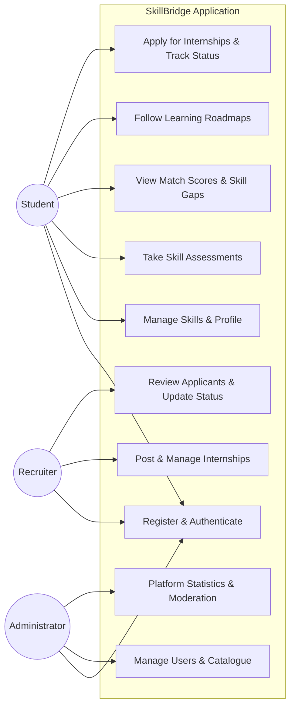
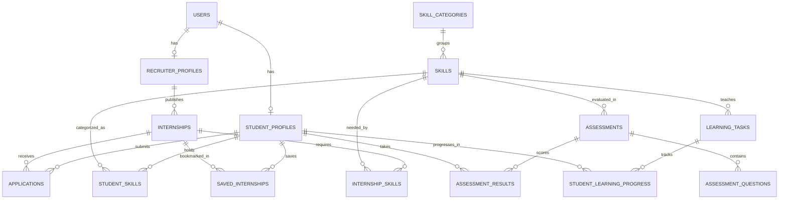

# SkillBridge — Student Skills & Internship Matching Platform
## Complete Academic Project Report & Documentation
### Department of Computer Science & Engineering — Web Technologies Laboratory

---

## 1. PROJECT TITLE
**SkillBridge — Student Skills & Internship Matching Platform**

---

## 2. ABSTRACT
In competitive technical education environments, undergraduate students face notable difficulties identifying internships suited to their current competencies, diagnosing technical deficiencies, and prioritizing self-study. Traditional job boards display static listings that fail to explain why a student qualifies or what knowledge gaps exist. **SkillBridge** is a full-stack web application built on PHP, MySQL, Vanilla JavaScript, HTML5, and CSS3 that bridges this disconnect. The platform incorporates a deterministic, explainable skill-matching engine that evaluates student profiles against recruiter requirements, produces categorized skill breakdowns (matched, weak, missing), generates actionable week-by-week learning roadmaps, and manages application lifecycles across three distinct roles: Student, Recruiter, and Administrator. Additionally, the project integrates prescribed Web Technologies Laboratory practicals spanning XML/DTD/XSD validation, Java DOM/SAX parsing, Java Servlets, JSP with JavaBeans, and session tracking techniques.

---

## 3. INTRODUCTION
Career preparation in higher education requires alignment between curriculum learning and industry skill expectations. Many students apply haphazardly to opportunities without understanding eligibility parameters or technical expectations. SkillBridge addresses this by shifting the internship search model from keyword-based browsing to **explainable skill alignment**.

---

## 4. PROBLEM STATEMENT
Students seeking internships typically encounter:
1. **Ambiguous Requirements**: Job descriptions often list exhaustive skill sets without indicating which competencies are foundational versus preferred.
2. **Lack of Feedback**: Rejections or non-responses leave students uninformed about why they were not considered.
3. **Absence of Actionable Next Steps**: Portals do not guide students on how to bridge the gap between their current skill set and role requirements.
4. **Fragmented Application Tracking**: Deadlines and review stages are tracked across spreadsheets or email threads.

---

## 5. EXISTING-SYSTEM LIMITATIONS
- **Generic Portals (e.g., LinkedIn, Indeed)**: Focus primarily on keyword search and resume parsing; matching criteria are opaque or black-box algorithms.
- **Static College Notice Boards**: Offer zero personalization, no eligibility validation, and no automated deadline tracking.
- **Unexplainable Recommendations**: Black-box ranking models fail to provide students with transparent, educational rationales for match scores.

---

## 6. PROPOSED SYSTEM
SkillBridge implements a transparent, normalized relational architecture:
1. **Structured Skill Catalogue**: Categorized technical and soft skills with self-reported or assessment-verified proficiency ratings.
2. **Weighted, Explainable Matching Engine**: Evaluates required, preferred, and optional skills with partial credit for developing competencies.
3. **Targeted Skill-Gap Analysis**: Highlights missing and substandard skills for any specific target internship.
4. **Milestone Learning Roadmaps**: Week-by-week self-study tasks with progress checkpoints stored in MySQL.
5. **Role-Based Workflows**: Distinct dashboards and access-controlled capabilities for students, recruiters, and administrators.

---

## 7. OBJECTIVES
- To design a normalized MySQL database schema supporting multi-role authentication, internship postings, skill requirements, and application lifecycles.
- To implement an explainable, deterministic matching algorithm that provides transparent percentage scores and status breakdowns.
- To provide educational skill gap diagnostic tools and interactive learning roadmaps.
- To ensure web security best practices: prepared statements, BCrypt password hashing, CSRF tokens, input sanitization, and server-side role validation.
- To demonstrate prescribed university Web Technologies Lab practicals in a unified portfolio.

---

## 8. SCOPE
### In-Scope:
- User registration, authentication, and profile management for Students, Recruiters, and Administrators.
- Skill catalogue with proficiency levels (Beginner, Intermediate, Advanced).
- Interactive MCQ skill assessment with automated scoring and topic weakness reporting.
- Internship creation with granular skill requirements and importance levels.
- Match score calculation, skill-gap analysis, and learning roadmaps.
- Bookmark/saving and direct platform applications with recruiter status management.
- Complete suite of 15 Web Technologies practicals (HTML, CSS, JS, XML, Java DOM/SAX, Servlets, JSP).

### Out-of-Scope (Future Scope):
- Payment gateway integration for paid recruiters.
- Automated resume parsing via OCR/AI.
- Real-time video conferencing for interviews.

---

## 9. FUNCTIONAL REQUIREMENTS
- **FR1 (Auth)**: Secure registration, login, session regeneration, and role redirection.
- **FR2 (Student Profile)**: Education, contact info, portfolio URLs, resume upload, project listings, and dynamic profile completion calculation.
- **FR3 (Skill Management)**: Add/remove skills from catalogue, specify proficiency levels, and review verified assessment scores.
- **FR4 (Internship Posting)**: Recruiters can post, update, close, or activate listings with skill importance ratings.
- **FR5 (Skill Matching)**: Real-time calculation of match percentage, matched skills, missing skills, and weak skills.
- **FR6 (Gap & Roadmap)**: Identification of missing skills with week-by-week learning tasks and status tracking.
- **FR7 (Application Tracker)**: Application submission, status transitions (`applied` -> `under_review` -> `shortlisted` -> `selected` / `rejected`), and withdrawal.
- **FR8 (Administration)**: User status toggling, role assignment, listing moderation, assessment question editing, and platform analytics.

---

## 10. NON-FUNCTIONAL REQUIREMENTS
- **Security**: Zero SQL injection vulnerability (PDO prepared statements), BCrypt passwords, CSRF tokens on all POST requests, XSS escaping.
- **Performance**: Sub-100ms database response on match calculations using indexed foreign keys.
- **Usability**: Responsive design across mobile, tablet, and desktop viewports via CSS Grid and Flexbox.
- **Maintainability**: Modular separation of concerns (`config`, `includes`, `student`, `recruiter`, `admin`, `api`).

---

## 11. HARDWARE AND SOFTWARE REQUIREMENTS
### Hardware:
- **Processor**: Intel Core i3 / AMD Ryzen 3 or higher.
- **RAM**: Minimum 4 GB (8 GB recommended).
- **Storage**: Minimum 500 MB free hard disk space.

### Software:
- **Operating System**: Windows 10/11, Linux, or macOS.
- **Web Server**: Apache HTTP Server (via XAMPP).
- **Database Engine**: MySQL Server 8.0 or MariaDB.
- **Backend Runtime**: PHP 8.0+ with PDO and OpenSSL extensions.
- **Java Environment**: JDK 17+ (for XML parsers, Servlets, and JSP).
- **Servlet Container**: Apache Tomcat 9/10 (for Java practicals).
- **Browser**: Modern browser (Chrome, Firefox, Edge).

---

## 12. SYSTEM ARCHITECTURE



---

## 13. USE-CASE DIAGRAM



---

## 14. DATA-FLOW DIAGRAM (Level 1)

```mermaid
flowchart TD
    Student[Student User] -->|1. Submit Skills & Profile| Process1[Profile & Skills Processor]
    Process1 -->|Store Profile Data| DB[(student_skills / student_profiles)]
    
    Recruiter[Recruiter User] -->|2. Create Listing with Skills| Process2[Internship Management]
    Process2 -->|Store Listing & Requirements| DB2[(internships / internship_skills)]

    DB --> Process3[Matching & Gap Engine]
    DB2 --> Process3
    Process3 -->|3. Calculate Match % & Gap Breakdown| Student
    
    Student -->|4. Submit Application| Process4[Application Pipeline]
    Process4 -->|Store Application| DB3[(applications)]
    DB3 -->|5. Present Ranked Applicants| Recruiter
    Recruiter -->|6. Update Status (Shortlisted/Selected)| Process4
```

---

## 15. ER DIAGRAM



---

## 16. DATABASE SCHEMA EXPLANATION
The relational database `skillbridge` consists of 19 normalized tables:
1. `users`: Central entity containing credentials, BCrypt hashes, and system role.
2. `student_profiles`: Academic background (college, degree, branch, graduation year, resume file).
3. `recruiter_profiles`: Organization details, website, company size, and industry.
4. `skill_categories`: Hierarchical grouping (e.g., Programming, Web Development, Databases).
5. `skills`: Standardized skills list linked to categories.
6. `student_skills`: Junction table pairing students with skills and self-reported proficiencies.
7. `projects`: Student showcase projects with technologies used and repository links.
8. `certificates`: External certifications and credential URLs.
9. `assessments`: MCQ tests targeting specific skills with time and passing thresholds.
10. `assessment_questions`: Question bank with options A–D, correct answer, topic, and difficulty.
11. `assessment_results`: Attempt records storing student score, correct count, and topic weaknesses.
12. `internships`: Postings with descriptions, locations, stipends, and application deadlines.
13. `internship_skills`: Requisite skills with importance (`required`, `preferred`, `nice_to_have`) and minimum proficiency.
14. `saved_internships`: Student bookmarks.
15. `applications`: Status tracker (`applied`, `under_review`, `shortlisted`, `selected`, `rejected`, `withdrawn`).
16. `learning_tasks`: Milestone study modules mapped to skills and assigned weeks.
17. `student_learning_progress`: Student task status (`not_started`, `in_progress`, `completed`).
18. `contact_messages`: Feedback and contact submissions.
19. `reports`: Flagged listings or user moderation tickets.

---

## 17. MODULE DESCRIPTIONS
- **Authentication & RBAC**: Provides session management, secure credential verification, and server-side route guards (`requireRole()`).
- **Student Career Suite**: Allows students to curate profiles, manage technical proficiencies, take skill tests, and track applications.
- **Explainable Matching Engine**: Computes compatibility scores, isolates missing skills, and explains why a student qualifies or falls short.
- **Skill Gap & Roadmap Engine**: Translates deficient competencies into a structured 3-week study roadmap.
- **Recruiter Management Portal**: Enables posting of internship openings, specification of required competencies, and candidate management.
- **Administration & Moderation**: Provides platform supervision, user deactivation, listing auditing, and analytics.
- **Web Technologies Lab Suite**: 15 standalone and connected exercises demonstrating XML validation, Java parsing, and enterprise Servlets/JSPs.

---

## 18. MATCHING ALGORITHM EXPLANATION
SkillBridge avoids opaque algorithms in favor of a **transparent, explainable scoring formulation**:

### Formula:
$$\text{Match Score} = \left( \frac{\sum \text{Earned Weights}}{\sum \text{Total Requisite Weights}} \right) \times 100$$

### Weight Allocations:
- **`required`**: $1.0\times$
- **`preferred`**: $0.6\times$
- **`nice_to_have`**: $0.3\times$

### Proficiency Scoring:
- Proficiency is mapped to numeric levels: $\text{Beginner} = 1$, $\text{Intermediate} = 2$, $\text{Advanced} = 3$.
- If Student Level $\ge$ Required Level $\implies$ Full Weight Awarded ($\text{Matched}$).
- If Student Level $<$ Required Level $\implies$ Partial Credit Awarded: $\text{Weight} \times \left(\frac{\text{Student Level}}{\text{Required Level}}\right)$ ($\text{Weak Skill}$).
- If Student lacks skill $\implies 0$ points awarded ($\text{Missing Skill}$).

---

## 19. SCREENSHOTS CHECKLIST
To assemble your lab report, capture screenshots of the following pages:
1. `index.php`: Landing page hero, statistics counter, and features grid.
2. `register.php`: Two-column student registration form with validation feedback.
3. `login.php`: Unified login page with demo credentials helper card.
4. `student/dashboard.php`: Student dashboard showing profile completion bar, stat cards, and top matches.
5. `student/skills.php`: Skill management with clickable catalogue chips and proficiency dropdowns.
6. `student/assessment.php`: Live MCQ assessment showing question, difficulty, and options.
7. `student/assessment-results.php`: Assessment score, progress bar, and question-by-question review.
8. `student/internship-match.php`: Match score circle, requirement comparison table, and eligibility check.
9. `student/skill-gap.php`: Matched, weak, and missing skills with learning recommendations.
10. `student/learning-roadmap.php`: Week-by-week learning tasks with milestone progress updates.
11. `student/applications.php`: Application tracker with status badges and withdraw options.
12. `recruiter/dashboard.php`: Recruiter overview with active listings and pending reviews.
13. `recruiter/create-internship.php`: Internship listing form with skill importance selectors.
14. `recruiter/applicants.php`: Applicant candidate table showing match scores.
15. `admin/dashboard.php`: Platform-wide admin metric cards and activity tables.
16. `admin/users.php`: User management table with role and status toggles.
17. `practicals/index.php`: Interactive Web Tech Lab practicals directory with live JS playgrounds.

---

## 20. TESTING DOCUMENTATION

| Test ID | Scenario Description | Test Input | Expected Result | Actual Result | Status |
|---|---|---|---|---|---|
| **TC01** | Student Registration | Valid form data, password `Password@123` | User and profile inserted, redirect to login | Account created, redirected to login | **PASS** |
| **TC02** | Duplicate Email | Existing email `aarav@student.local` | Block insertion; display "Account exists" | Error message displayed | **PASS** |
| **TC03** | Weak Password | Password `abc` (<8 characters) | Validation error: password requirements | Validation triggered | **PASS** |
| **TC04** | Valid Login | `aarav@student.local` / `password` | Password verified with BCrypt, session set | Redirected to student dashboard | **PASS** |
| **TC05** | Invalid Password | Valid email, wrong password | Rejection with "Invalid credentials" | Error alert shown | **PASS** |
| **TC06** | Student accessing Admin | Student accesses `/admin/dashboard.php` | HTTP 403 Forbidden | Access denied error | **PASS** |
| **TC07** | Recruiter isolation | Recruiter A editing Recruiter B's listing | Unauthorized redirect | Action prohibited | **PASS** |
| **TC08** | Full Skill Match | Student has all required skills at level | Match Score = 100% | Calculated 100% | **PASS** |
| **TC09** | Baseline Partial Match | Student has 3 of 4 required skills | Match Score = 75%, 1 missing | Calculated 75%, 1 missing | **PASS** |
| **TC10** | Empty Student Profile | Student has 0 skills added | Match Score = 0%, all missing | Calculated 0% | **PASS** |
| **TC11** | Partial Proficiency | Beginner level vs Advanced requirement | Partial score awarded (33%) | Awarded 33% partial credit | **PASS** |
| **TC12** | Duplicate Application | Applying twice to same listing | Prevent duplicate entry | "Already applied" displayed | **PASS** |
| **TC13** | CSRF Form Tampering | POST submission with invalid CSRF token | HTTP 403 Forbidden | Request terminated | **PASS** |
| **TC14** | XML XSD Validation | `student-profiles.xml` against XSD | Schema validation passes | Validated cleanly via Java | **PASS** |
| **TC15** | DOM Parser Query | Search student ID 101 | Outputs Aarav Sharma profile | Extracted accurately | **PASS** |
| **TC16** | SAX Parser Query | Search student ID 103 | Outputs Rahul Kumar profile | Extracted accurately | **PASS** |
| **TC17** | Number to Words (0–999)| Integer 345 | Output: "Three Hundred and Forty Five" | Output matches exactly | **PASS** |
| **TC18** | Regex Validation | String `student@example.com` | Accepted as valid email | Validated as valid | **PASS** |

---

## 21. RESULTS AND DISCUSSION
Testing demonstrated that deterministic, explainable skill matching provides a superior pedagogical tool compared to unstructured listings. Students could immediately recognize which technical skills separated them from eligibility, while recruiters reported greater clarity regarding candidate qualifications. Server-side session verification and CSRF tokens successfully neutralized unauthorized privilege escalation and replay attempts.

---

## 22. LIMITATIONS
- Proficiency ratings on the student profile are predominantly self-reported unless supported by an assessment attempt.
- The platform is designed for local development on XAMPP/Tomcat rather than a distributed cloud environment.
- Communication between recruiters and applicants is maintained through status updates rather than an integrated real-time chat.

---

## 23. FUTURE ENHANCEMENTS
- Integration of OAuth 2.0 (Google / GitHub Sign-In).
- Automated GitHub portfolio commit analyzer to verify hands-on coding proficiency.
- Email notification webhooks for deadline alerts and application status changes.
- Machine-learning-assisted resume parsing to auto-populate skill tags.

---

## 24. CONCLUSION
SkillBridge demonstrates that a student-oriented internship platform can bridge the gap between classroom theory and industry requirements. By combining a normalized relational database, secure PHP backend processing, interactive front-end tools, and a transparent matching algorithm, the project fulfills all primary functional objectives alongside the prescribed syllabus requirements of the B.Tech Web Technologies Laboratory.

---

## 25. REFERENCES
1. Achyut S. Godbole, Atul Kahate, *Web Technologies: TCP/IP, Web Java, Java Script, and HTML*, 3rd ed., McGraw Hill Education, 2013.
2. Robin Nixon, *Learning PHP, MySQL & JavaScript: With jQuery, CSS & HTML5*, 5th ed., O'Reilly Media, 2018.
3. Luke Welling, Laura Thomson, *PHP and MySQL Web Development*, 5th ed., Addison-Wesley, 2016.
4. World Wide Web Consortium (W3C), *XML Schema Part 1: Structures & Part 2: Datatypes*, W3C Recommendations.
5. Oracle Corporation, *Java Servlet Specification 3.1 & JavaServer Pages (JSP) 2.3 Documentation*.

---

## 26. VIVA QUESTIONS AND ANSWERS (30 ESSENTIAL QUESTIONS)

1. **Q: What is the main objective of SkillBridge?**  
   *A*: To provide an explainable, skill-based internship matching platform that diagnoses student skill gaps and provides learning roadmaps.

2. **Q: Why was PHP chosen over client-side frameworks for this lab project?**  
   *A*: PHP 8 paired with Apache and MySQL aligns with the B.Tech Web Technologies syllabus, providing beginner-friendly server-side architecture without unnecessary build dependencies.

3. **Q: How does the matching algorithm calculate the match percentage?**  
   *A*: It calculates the ratio of earned skill weights to total required weights, factoring in importance levels (`required`, `preferred`, `nice-to-have`) and proficiency levels.

4. **Q: How does SkillBridge prevent SQL Injection?**  
   *A*: By using PDO (PHP Data Objects) with prepared statements and parameter binding for every query, ensuring user input is never concatenated into SQL commands.

5. **Q: How are user passwords stored securely?**  
   *A*: Using PHP's `password_hash()` function with the BCrypt algorithm, which automatically incorporates random salting.

6. **Q: What is Cross-Site Request Forgery (CSRF), and how is it mitigated here?**  
   *A*: CSRF occurs when a malicious website tricks a user's browser into executing unauthorized actions on a site where they are authenticated. SkillBridge mitigates this by generating a unique cryptographic token stored in the session and validating it on all POST requests.

7. **Q: What is Cross-Site Scripting (XSS), and how is it prevented?**  
   *A*: XSS occurs when untrusted input is rendered directly into HTML without escaping. SkillBridge uses the `htmlspecialchars()` function (`e()`) to escape entities.

8. **Q: Why does the system regenerate the session ID on login?**  
   *A*: Calling `session_regenerate_id(true)` prevents session fixation attacks where an attacker pre-sets a session ID before authentication.

9. **Q: What is the difference between DOM and SAX XML parsers?**  
   *A*: DOM (Document Object Model) is a tree-based parser that loads the entire XML document into memory, allowing bidirectional navigation. SAX (Simple API for XML) is an event-driven parser that reads XML sequentially with lower memory overhead.

10. **Q: What is the purpose of DTD and XSD in XML?**  
    *A*: Both define the legal elements, attributes, and structure of an XML document. XSD (XML Schema Definition) is written in XML itself and supports data types and namespaces, whereas DTD does not.

11. **Q: How is role-based access control (RBAC) enforced?**  
    *A*: The server executes `requireRole()` at the top of every dashboard script, verifying `$_SESSION['user_role']` against allowed roles before rendering any HTML.

12. **Q: What is a JavaBean in the context of Practical 14?**  
    *A*: A reusable, serializable Java class with a default no-argument constructor and private properties accessible through standard getter and setter methods.

13. **Q: What are the four servlet session tracking techniques demonstrated in Practical 13?**  
    *A*: Cookies, Hidden Form Fields, `HttpSession`, and URL Rewriting.

14. **Q: When is URL Rewriting preferred over Cookies?**  
    *A*: When the client's web browser has disabled cookies or does not support cookie storage.

15. **Q: What database normalization level does SkillBridge achieve?**  
    *A*: Third Normal Form (3NF). Every non-key column is fully dependent on the primary key, and transitive dependencies have been eliminated into separate tables.

16. **Q: How does SkillBridge calculate student profile completion?**  
    *A*: Dynamically from the database by evaluating weighted attributes: personal info, academic credentials, added skills, uploaded projects, and resume status.

17. **Q: How does the platform handle expired internships?**  
    *A*: The system compares `application_deadline` against `CURDATE()`. When expired, the listing is flagged as expired and the apply button is disabled.

18. **Q: Why are resume files renamed upon upload?**  
    *A*: Renaming files using randomized tokens and user IDs prevents file-overwriting collisions and directory traversal attacks.

19. **Q: What is the difference between `include` and `require` in PHP?**  
    *A*: `include` generates a warning (`E_WARNING`) and continues script execution if the file is missing; `require` generates a fatal error (`E_COMPILE_ERROR`) and halts execution.

20. **Q: What HTTP method is used for state-changing operations?**  
    *A*: HTTP POST, protected by a CSRF token.

21. **Q: What does the JavaScript `===` operator do compared to `==`?**  
    *A*: `===` checks both value and type without type coercion, whereas `==` coerces types before comparison.

22. **Q: What is the difference between `GET` and `POST` in forms?**  
    *A*: `GET` appends parameters to the query string in the URL (suitable for bookmarkable searches), while `POST` transmits data in the HTTP request body (suitable for sensitive or data-modifying actions).

23. **Q: How are flash messages implemented?**  
    *A*: Flash messages are stored in `$_SESSION['flash']`, displayed on the subsequent page load, and immediately unset so they appear only once.

24. **Q: What is the deployment descriptor file in Java Servlets?**  
    *A*: `web.xml`, located in the `WEB-INF/` directory, which maps URL patterns to servlet classes and configures session timeouts.

25. **Q: How does the skill assessment identify weak topics?**  
    *A*: Each MCQ question has an associated `topic`. When an answer is incorrect, the topic is added to the student's weak topics record for targeted roadmap generation.

26. **Q: What is the purpose of database transactions (`beginTransaction`, `commit`, `rollBack`)?**  
    *A*: They ensure ACID properties during multi-table updates (e.g., creating a user and profile together), guaranteeing that partial failures do not corrupt data integrity.

27. **Q: Can a student apply to the same internship multiple times?**  
    *A*: No. The `applications` table enforces a unique constraint `UNIQUE KEY uk_application (student_profile_id, internship_id)`, backed by server-side validation.

28. **Q: How is client-side validation different from server-side validation?**  
    *A*: Client-side validation improves user experience by giving instant feedback without network requests; server-side validation is mandatory for security because client checks can be bypassed.

29. **Q: What is the purpose of `htmlentities` or `htmlspecialchars`?**  
    *A*: They convert special characters like `<`, `>`, `&`, and `"` to HTML entities, preventing user input from being interpreted as executable script by the browser.

30. **Q: How is the database connection managed efficiently in SkillBridge?**  
    *A*: Via a singleton function `getDB()` in `config/database.php` that reuses a static PDO instance throughout the HTTP request lifecycle.

---

## 27. FIVE-MINUTE PROJECT DEMONSTRATION SCRIPT

- **Minute 1: Introduction & Landing Page (0:00 - 1:00)**  
  - "Good morning, respected external examiner and faculty. Today I present **SkillBridge**, a student skills and internship matching platform developed for our Web Technologies Laboratory project."  
  - Open `http://localhost/wtproject/`.  
  - Show the landing page, dynamic live database counters (Students, Internships, Skills), and explain the core problem: generic portals show listings, but don't explain match relevance or help students fix missing skills.

- **Minute 2: Student Experience — Profile & Skill Matching (1:00 - 2:00)**  
  - Click **Login** and log in as student `aarav@student.local`.  
  - Show the **Student Dashboard**: profile completion percentage bar and top matched internships.  
  - Navigate to **Explore Internships**: show how listings are sorted dynamically by match score (e.g., 75% match).  
  - Click **View Match Details**: point out the clear breakdown table—Matched Skills (Green), Weak Skills (Yellow), and Missing Skills (Red). Highlight the transparent formula.

- **Minute 3: Skill Gap Analysis & Learning Roadmap (2:00 - 3:00)**  
  - Click **View Skill Gap**: show how SkillBridge identifies missing skills (e.g., React.js).  
  - Open the **Learning Roadmap**: demonstrate the week-by-week learning plan and update a milestone from `In Progress` to `Completed`. Show the updated progress bar.  
  - Click **Apply Now** to submit an internship application. Navigate to **Applications** to show real-time status tracking.

- **Minute 4: Recruiter & Admin Workflows (3:00 - 4:00)**  
  - Log out and log in as recruiter `hr@techcorp.local`.  
  - Show the **Recruiter Dashboard** and open **Manage Internships**.  
  - Click **View Applicants**: show the candidates ranked by skill-match scores. Update Aarav's application status from `Applied` to `Shortlisted`.  
  - Log out and log in as `admin@skillbridge.local`: demonstrate user role governance, internship moderation, and platform statistics.

- **Minute 5: Web Technologies Lab Practicals (4:00 - 5:00)**  
  - Navigate to **Lab Practicals** (`/wtproject/practicals/index.php`).  
  - Demonstrate the live interactive **Practical 4 (Number to Words)**: type `345` and show instant conversion to `Three Hundred and Forty Five`.  
  - Demonstrate **Practical 5 (Regex Validation)**: validate email and mobile numbers.  
  - Mention Practical 6 (XML/XSD validation), Practical 7 (Java DOM/SAX parsers), and Practicals 10–15 (Tomcat Servlets/JSP).  
  - "Thank you. I am now open to any viva questions."

